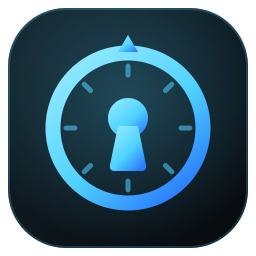

# Ely Vault UI

**Client de bureau rapide et sobre pour Vaultwarden / Bitwarden, pensé pour le clavier.**

---

Ely Vault UI est une interface de bureau au-dessus du **CLI Bitwarden officiel** (`@bitwarden/cli`). Elle se connecte à n'importe quel serveur **Vaultwarden** ou **Bitwarden** et permet de retrouver, consulter et utiliser ses secrets sans quitter le clavier.

Toute la cryptographie est déléguée au CLI officiel : l'application n'implémente aucun algorithme de chiffrement.

> **Statut** : version 1, en lecture seule. La création et la modification d'éléments se font depuis le coffre web.

## Fonctionnalités

- **Recherche instantanée** dans tout le coffre, filtres par type, dossier, organisation et collection.
- **Palette de commandes** (`Ctrl K`) : chercher et copier un mot de passe, un identifiant ou un code TOTP en deux touches.
- **Saisie automatique** façon KeePass : `Ctrl V` tape l'identifiant puis le mot de passe dans l'application ouverte juste avant.
- **Tous les types d'éléments** : identifiants, codes TOTP, cartes, identités, notes sécurisées, clés SSH, champs personnalisés.
- **Presse-papiers maîtrisé** : effacement automatique, exclusion de l'historique Windows (`Win V`) et du presse-papiers cloud.
- **Verrouillage automatique** : inactivité, verrouillage de session, mise en veille, fermeture.
- **Re-saisie du mot de passe maître** pour les éléments protégés (« reprompt »).
- **Générateur de mot de passe**.
- **PKI d'entreprise et certificats auto-signés** : revue et approbation explicite de l'autorité racine, sans jamais désactiver la vérification TLS.

## Installation

Les installeurs Windows (NSIS) et Linux (AppImage, `.deb`) sont publiés dans les [releases GitHub](https://github.com/Elyspio/ely-vault-ui/releases) ; l'application se met ensuite à jour seule. Détails : [Installation](docs/utilisation/installation.md), [Mises à jour](docs/utilisation/mises-a-jour.md).

## Documentation

| Utilisation                                                       | Technique                                          | Développement                                                        |
| ----------------------------------------------------------------- | -------------------------------------------------- | -------------------------------------------------------------------- |
| [Installation](docs/utilisation/installation.md)                  | [Architecture](docs/technique/architecture.md)     | [Démarrage](docs/developpement/demarrage.md)                         |
| [Mises à jour](docs/utilisation/mises-a-jour.md)                  | [Modèle de sécurité](docs/technique/securite.md)   | [Publier une version](docs/developpement/publier-une-version.md)     |
| [Saisie automatique](docs/utilisation/saisie-automatique.md)      |                                                    | [Serveur de test local](docs/developpement/serveur-de-test-local.md) |
| [Raccourcis clavier](docs/utilisation/raccourcis-clavier.md)      |                                                    |                                                                      |

## Licence

Distribué sous licence [MIT](LICENSE).

Projet indépendant, non affilié à Bitwarden Inc. ni au projet Vaultwarden. « Bitwarden » est une marque de Bitwarden Inc.
